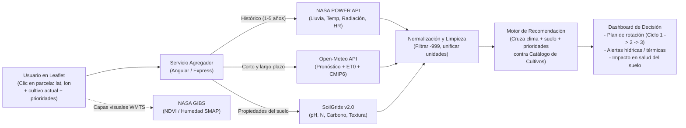

# Contexto del Proyecto — `agro-nasa`

## 1. Desafío (NASA Space Apps Challenge 2026)
**Reto:** *Cambio de rumbo: Adaptando las granjas con datos de la NASA*

### Problema
Los agricultores enfrentan cambios en las temperaturas, variaciones en los patrones de lluvia, escasez de agua, eventos meteorológicos extremos y deterioro de la salud del suelo. Esto dificulta elegir rotaciones de cultivos que protejan los campos, conserven el agua y fomenten la resiliencia a largo plazo.

### Objetivo de la solución
Construir una **herramienta de apoyo a la toma de decisiones** que combine:
- Observaciones de la Tierra de la NASA (clima histórico, radiación, humedad, capas satelitales).
- Pronósticos y proyecciones climáticas futuras.
- Información del suelo (satelital/global + datos locales ingresados por el agricultor).
- Características agronómicas de los cultivos y prioridades del agricultor (ahorro de agua, regeneración de suelo, resiliencia térmica, etc.).

Con esto, el sistema sugiere **estrategias de rotación de cultivos** adaptadas a la ubicación exacta de la parcela.

---

## 2. Stack Tecnológico Actual
- **Frontend:** Angular `^20.3.0` (con `@angular/ssr` y Express `^5.1.0`)
- **Mapa interactivo:** Leaflet (selección de parcela/coordenadas `lat, lon` y visualización de capas satelitales)
- **Lenguaje:** TypeScript `~5.9.2`

---

## 3. APIs Seleccionadas hasta el Momento

### A. Clima Histórico y Observación Terrestre
1. **NASA POWER API (`POWER Daily API`)**
   - **Uso:** Clima histórico y reciente por punto (`lat`, `lon`).
   - **Parámetros clave ya probados:**
     - `PRECTOTCORR`: Precipitación corregida (`mm/day`)
     - `T2M`, `T2M_MAX`, `T2M_MIN`: Temperatura media, máxima y mínima a 2 m (`°C`)
     - `ALLSKY_SFC_SW_DWN`: Radiación solar incidente en superficie (`MJ/m²/day`)
     - `RH2M`: Humedad relativa a 2 m (`%`)
   - **Nota técnica importante:** Los días muy recientes sin procesar devuelven `fill_value: -999`. Siempre filtrar valores `=== -999` antes de graficar o calcular promedios.

### B. Clima Futuro y Pronóstico
2. **Open-Meteo API**
   - **Uso:**
     - **Forecast API:** Pronóstico a 7–16 días (lluvia, temperatura, evapotranspiración `et0_fao_evapotranspiration`, humedad del suelo por profundidad).
     - **Climate Change API (CMIP6):** Proyecciones climáticas futuras (tendencias de temperatura y precipitación a mediano/largo plazo para evaluar adaptación).
   - **Ventaja:** Gratuita, sin API key y compatible con peticiones directas desde navegador (CORS).

### C. Mapa y Capas Visuales
3. **Leaflet**
   - **Uso:** Selección de la ubicación de la finca/parcela (`lat`, `lon` o polígono) y renderizado de capas geoespaciales.

---

## 4. Ideas de APIs Adicionales (Cultivos, Suelo y Capas Satelitales)

Estas fuentes complementan perfectamente a NASA POWER + Open-Meteo sin complicar el hackathon:

### Suelo (Fundamental para el reto)
1. **ISRIC SoilGrids v2.0 REST API** *(Gratuita, sin API key)*
   - **Qué entrega por `lat, lon`:** pH del suelo (`phh2o`), carbono orgánico (`soc`), nitrógeno (`nitrogen`), porcentaje de arcilla/arena/limo (`clay`, `sand`, `silt`) y densidad aparente (`bdod`).
   - **Para qué sirve:** Diagnosticar la textura y salud base del suelo si el agricultor no tiene análisis de laboratorio, y combinarlo con observaciones locales.
2. **OpenEPI (Soil / Crop / Geoclimatic APIs)** *(Gratuita, enfocada en agricultura)*
   - **Qué entrega:** Resúmenes de suelo y condiciones agroclimáticas listas para apps agrícolas.

### Capas Satelitales NASA en Leaflet (Alto impacto visual)
3. **NASA GIBS (Global Imagery Browse Services - WMTS)** *(Sin API key)*
   - **Qué entrega:** Tiles de mapa listos para montar directo en Leaflet (`L.tileLayer`), por ejemplo:
     - **NDVI (MODIS / VIIRS):** Índice de vegetación / vigor de cultivos.
     - **SMAP:** Humedad superficial del suelo.
     - **Anomalías de temperatura superficial.**
   - **Para qué sirve:** Que el agricultor vea en el mapa el estado real de vegetación/humedad de su zona con datos oficiales de la NASA.

### Cultivos y Reglas de Rotación
4. **Catálogo Curado de Cultivos (JSON local en el proyecto) + OpenFarm / FAO Crop Info (opcional)**
   - **Por qué un JSON local curado:** Las APIs públicas de botánica (como Trefle o Perenual) suelen tener límites estrictos o carecer de reglas agronómicas de *rotación*. Tener un catálogo JSON propio (15–30 cultivos clave de la región/globales) garantiza velocidad, disponibilidad 100% offline/demo y control exacto sobre:
     - Familia botánica (ej. *Fabaceae/Leguminosas*, *Poaceae/Gramíneas*, *Solanaceae*, *Brassicaceae*, cultivos de cobertura).
     - Rol en la rotación (fijador de nitrógeno, alto extractor, cobertura protectora, rompe-ciclo de plagas).
     - Rangos óptimos: temperatura (`°C`), lluvia (`mm/ciclo`), pH del suelo, tolerancia a sequía y demanda hídrica.
5. **Nominatim (OpenStreetMap)** *(Opcional)*
   - **Uso:** Geocodificación inversa para mostrar el nombre del municipio/región al hacer clic en Leaflet.

---

## 5. Primer Flujo de Datos (Arquitectura Inicial)

### Paso a paso del flujo
1. **Entrada (Mapa + Perfil de Finca):**
   - El usuario selecciona su parcela en **Leaflet** (`lat`, `lon`).
   - Opcionalmente ingresa contexto local: cultivo anterior/actual, observaciones locales del suelo (ej. *compactado, arenoso, poca retención*) y prioridades (ej. *conservar agua*, *recuperar nitrógeno*, *resiliencia a calor*).
2. **Consulta en paralelo a las fuentes:**
   - **NASA POWER:** Descarga serie diaria histórica para calcular promedios estacionales, picos de calor y déficit/exceso de lluvia.
   - **Open-Meteo:** Obtiene pronóstico inmediato (próximos 16 días) y tendencia futura (CMIP6) + evapotranspiración (`ET0`).
   - **SoilGrids:** Obtiene pH, textura y materia orgánica estimada del punto.
   - **NASA GIBS:** Carga capas visuales (NDVI / humedad) directo sobre Leaflet.
3. **Limpieza y normalización:**
   - Se eliminan los valores `-999` de NASA POWER.
   - Se construye un objeto unificado `FarmEnvironmentProfile` con indicadores claros: *temperatura media, riesgo de ola de calor, lluvia acumulada, balance hídrico (Lluvia - ET0), pH y textura del suelo*.
4. **Motor de recomendación de rotación:**
   - Evalúa compatibilidad climática (presente y futura) y de suelo de cada cultivo.
   - Aplica reglas agronómicas de rotación (ej. no repetir familia botánica consecutivamente; alternar cultivos extractores con leguminosas fijadoras de nitrógeno o cultivos de cobertura cuando el suelo/agua lo requieran).
5. **Visualización y explicación:**
   - Muestra al agricultor una secuencia sugerida (Ciclo 1 → Ciclo 2 → Ciclo 3), el porqué basado en datos NASA y alertas accionables.
