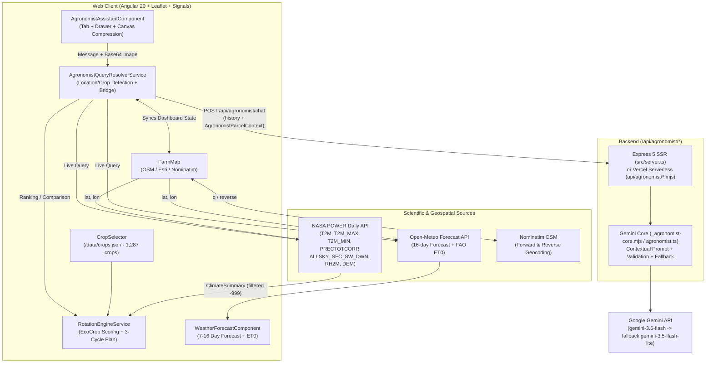

# 01. Architecture and Tech Stack

[← Back to Introductory README](../README.md)

This document describes the tools, programming languages, software architecture, and technical data flow of **AgroHelper**.

---

## 1. Tech Stack

| Layer | Technology / Version | Purpose in AgroHelper |
| :--- | :--- | :--- |
| **Frontend Framework** | Angular `^20.3.0` (Standalone Components + Signals + OnPush) | Four-step reactive interface (`Map`, `Crops`, `Recommendations`, `Superintelligence`) and Signal-based state management. |
| **Languages** | TypeScript `~5.9.2` / ESM JavaScript (`.mjs`) | Strictly typed client/SSR application and lightweight Node.js serverless functions. |
| **SSR & Local Backend** | `@angular/ssr` `^20.3.11` + Express `^5.1.0` | Server-side rendering (`src/server.ts`) and `/api/agronomist/*` API endpoints. |
| **Cloud Hosting** | Vercel (`Node 22.x`, Serverless Functions in `api/`) | Hosts the Angular SSR build and serverless Gemini proxy endpoints. |
| **Mapping** | Leaflet `^1.9.4` + `@types/leaflet` | Interactive map rendering, parcel selection, and base-layer switching (OSM / Esri Satellite). |
| **Superintelligence (SI)** | `@google/genai` `^3.3.0` (`gemini-3.6-flash` / `gemini-3.5-flash-lite`) | Contextual agronomic assistant and multimodal image analysis. |
| **Data Processing** | `csv-parse` `^7.0.3` + `node --experimental-strip-types` | Converts and normalizes the raw FAO EcoCrop CSV (`EcoCrop_DB.csv`) into `public/data/crops.json`. |
| **Unit Testing** | Jasmine `~5.9.0` + Karma `~6.4.0` | Unit tests for components, rotation engine, query parser, and AI service. |

---

## 2. System Architecture and Data Flow

AgroHelper uses a hybrid client-server architecture:
- Geographic, climate, and crop catalog lookups run directly from the browser against CORS-enabled public APIs (**NASA POWER**, **Open-Meteo**, **Nominatim**) and the static asset `/data/crops.json`.
- Calls to **Google Gemini** always go through AgroHelper's backend (`/api/agronomist/status` and `/api/agronomist/chat`) to protect `GEMINI_API_KEY` server-side and enforce MIME/size limits and model fallback.



---

## 3. Repository Structure

```text
agro-nasa/
├── api/                                  # Vercel Serverless Functions
│   ├── _agronomist-core.mjs              # Shared Gemini logic (prompt, history, errors, fallback)
│   └── agronomist/
│       ├── chat.mjs                      # POST /api/agronomist/chat
│       └── status.mjs                    # GET /api/agronomist/status
├── public/
│   └── data/
│       └── crops.json                    # Processed FAO EcoCrop catalog (1,287 crops, ~1.8 MB)
├── scripts/
│   └── convert-ecocrop.ts                # Converts EcoCrop_DB.csv into crops.json
├── src/
│   ├── index.html                        # Root HTML and Google Font loading (Outfit)
│   ├── server.ts                         # Express SSR server (/api/agronomist/* and /browser)
│   ├── server/
│   │   └── agronomist.ts                 # Equivalent TypeScript implementation for SSR server
│   └── app/
│       ├── pages/dashboard/              # Main 4-step orchestrator and Signal state
│       ├── components/
│       │   ├── farm-map/                 # Leaflet map, Nominatim search, GPS, layer switcher
│       │   ├── crop-selector/            # Crop browser, category filters, and "Suggested" tab
│       │   ├── rotation-timeline/        # 3-cycle rotation timeline and environmental alerts
│       │   ├── weather-forecast/         # 7/16-day forecast, WMO icons, and water balance
│       │   └── agronomist-assistant/     # Agronomic chat (full tab + floating drawer + uploads)
│       ├── services/
│       │   ├── nasa-power.service.ts     # NASA POWER Daily API client + -999 cleaning
│       │   ├── open-meteo.service.ts     # Open-Meteo Forecast client + shareReplay cache
│       │   ├── soil-grids.service.ts     # Scaffolded stub for ISRIC SoilGrids v2.0 integration
│       │   ├── farm-aggregator.service.ts# Parallel forkJoin aggregator -> FarmEnvironmentProfile
│       │   ├── rotation-engine.service.ts# Trapezoidal scoring, evaluateCrop, and generatePlan
│       │   ├── agronomist-ai.service.ts  # Chat state, Dashboard bridge, and API requests
│       │   └── agronomist-query-resolver.service.ts # Live entity resolution from user prompts
│       ├── utils/
│       │   ├── nasa-cleaner.utils.ts     # Fill-value (-999) filtering and valid averages
│       │   ├── forecast-summary.utils.ts # Converts forecast data into 7-day climate summary
│       │   ├── water-balance.utils.ts    # Computes water balance (Precipitation - ET0)
│       │   ├── agronomist-context.utils.ts # Builds AgronomistParcelContext payload
│       │   ├── agronomist-query-parser.utils.ts # Lightweight NLP parser & Spanish crop aliases
│       │   ├── image-compress.utils.ts   # Canvas resize (1280px max) and JPEG/WebP compression
│       │   └── markdown-blocks.utils.ts  # Safe Markdown block rendering in chat UI
│       ├── models/                       # TypeScript interfaces (Crop, ClimateSummary, RotationPlan, etc.)
│       └── data/
│           ├── EcoCrop_DB.csv            # Raw FAO EcoCrop dataset
│           └── Ecocrop_variable_lookup.csv
├── vercel.json                           # Vercel API route rewrites
├── angular.json                          # Angular SSR build configuration
└── package.json                          # Scripts and dependencies
```

---

## 4. Backend Endpoints

| Method | Route | Description |
| :--- | :--- | :--- |
| `GET` | `/api/agronomist/status` (and `/agronomist/status` in local SSR) | Checks if `GEMINI_API_KEY` is configured on the server and returns `defaultModel` and `fallbackModel`. |
| `POST` | `/api/agronomist/chat` (and `/agronomist/chat` in local SSR) | Accepts `{ messages, context }`, validates image format/size, builds the parcel-grounded system prompt, and returns `{ reply, model, usedFallback }`. |

### Dual SSR + Vercel Serverless Architecture
- During local SSR execution (`src/server.ts`), Express serves `/api/agronomist/*` directly via `src/server/agronomist.ts` with a `10mb` JSON body limit.
- In production on Vercel (`vercel.json`), `/api/agronomist/status` and `/api/agronomist/chat` route to dedicated serverless functions (`api/agronomist/status.mjs` and `api/agronomist/chat.mjs`) backed by `api/_agronomist-core.mjs`.

---

## 5. Bidirectional Dashboard ↔ Assistant Synchronization

Through `DashboardStateBridge` (`src/app/services/agronomist-ai.service.ts` and `src/app/pages/dashboard/dashboard.ts`):
1. Whenever the user selects a parcel on the map or picks a crop in the UI, `AgronomistParcelContext` updates reactively via `computed()` and is sent with every Gemini request.
2. Conversely, if the user types a location or crop directly in the chat (including from the floating drawer), `AgronomistQueryResolverService` updates the coordinates, NASA POWER climate summary, Open-Meteo forecast, and active crop in the `Dashboard` in real time.
